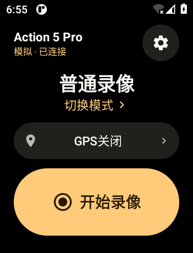
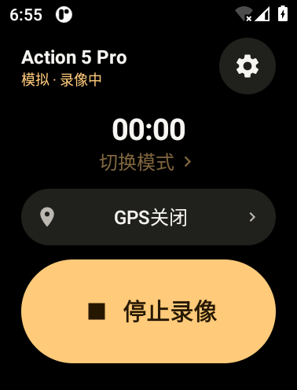
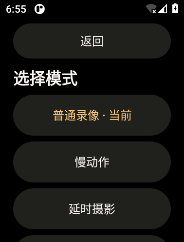
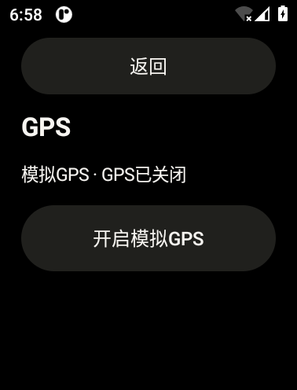

# Action Watch Remote

面向 OPPO Watch 4 Pro 与 DJI Osmo Action 5 Pro 的开源 Android 手表遥控应用，通过蓝牙连接相机，在手腕上控制录像、切换拍摄模式并推送 GPS 数据。

当前版本：**0.3 原型**。采用黑底琥珀色界面，大号录像按钮，模式与 GPS 各有独立页面。

## 功能

- **蓝牙连接与配对**：扫描附近 BLE 设备，选择相机，在相机端确认配对
- **录像控制**：开始、停止录像，显示录制时长；根据相机返回的状态更新界面
- **六种拍摄模式**：普通录像、慢动作、延时摄影、拍照、运动延时、低光视频，具体可用模式取决于相机和固件
- **GPS 推送**：手动开启后读取手表定位与 GGA NMEA 数据，通过蓝牙向当前相机发送位置、时间、高度和速度；页面显示定位状态
- **相机状态读取**：同步拍摄模式、录制状态、时长、电量、温度状态与电源状态；主界面聚焦连接、模式和录像操作
- **开发调试**：内置模拟相机、模拟 GPS 及故障注入工具，Debug 入口默认隐藏

应用以普通 Android APK 运行，无需账号或 Google Play Services。GPS 默认关闭，定位数据通过蓝牙发送；离开应用会停止 GPS 并断开连接，相机继续录制，可在相机端停止。

## 界面预览

以下为 0.3 最终版 APK 在 Android 模拟器中的实际截图（378 × 496，240 dpi），连接和定位场景使用内置模拟设备。

| 遥控主页 | 录像中 | 模式选择 | GPS 页面 |
| :---: | :---: | :---: | :---: |
|  |  |  |  |

[查看界面验收记录](docs/ui-v03/REPORT.md)

## 安装与使用

需要支持 BLE 的 Android 8.0（API 26）或更高版本设备。

1. 按下方开发说明构建 APK，或使用已有安装包，通过设备支持的方式侧载安装
2. 开启相机蓝牙，在应用中点击「连接相机」，按提示授予蓝牙或定位权限
3. 选择相机，在相机端确认配对，等待状态同步
4. 使用主页按钮控制录像，点击「切换模式」选择拍摄模式
5. 如需 GPS 数据，进入 GPS 页面，开启推送并授予精确定位权限，等待定位完成

详细步骤见[安装与真机测试](docs/INSTALL-TEST-ZH.md)。

### 兼容性与测试进度

目标设备为 OPPO Watch 4 Pro 与 Osmo Action 5 Pro。目前已完成 199 项 JVM 检查、Android 构建与 lint 检查，以及 240 / 320 dpi 模拟器界面验收；手表安装、相机配对与控制、真实 GPS 推送及素材中的 GPS 记录仍待真机验证。

## 开发

### 构建与测试

- JDK 17
- Android SDK 35（minSdk 26、targetSdk 35）
- Gradle 8.9（仓库附 Wrapper）、Android Gradle Plugin 8.7.3

配置 `JAVA_HOME` 与 `ANDROID_HOME` 后运行：

```sh
# 协议、GPS、模拟联调与 Debug 门控测试
./test.sh

# 构建调试 APK 并运行 Android lint
./gradlew :app:assembleDebug :app:lintDebug
```

构建产物位于 `app/build/outputs/apk/debug/app-debug.apk`。

### 调试模式

进入「设置 → 关于」，连续点击版本号 7 次，再返回设置打开 Debug，即可使用模拟相机、模拟 GPS 和故障注入。离开应用后，Debug 入口重新隐藏。

### 项目文档

- [构建与验证记录](docs/BUILD-RESULTS.md)
- [本机模拟指南](docs/SIMULATION-ZH.md)
- [协议实现与来源](docs/PROTOCOL.md)
- [官方工具帧校验结果](docs/OFFICIAL-FRAME-CHECK.txt)

欢迎通过 [Issues](https://github.com/QuinMeow/action-watch-remote/issues) 反馈问题或提交 Pull Request。设备兼容性反馈请附上手表系统、相机型号与固件版本、应用版本和复现步骤。

## 官方 SDK 与协议参考

蓝牙协议实现参考 DJI 官方 [Osmo GPS Controller Demo](https://github.com/dji-sdk/Osmo-GPS-Controller-Demo)，该仓库提供协议资料、示例代码与帧检查工具。

本项目为社区独立开发，与 DJI、OPPO 无官方隶属关系。

## 开源许可

- **本项目原创代码、测试与文档**采用 [MIT License](LICENSE)，可按许可使用、修改和分发
- **DJI 官方协议资料与示例代码**遵循[上游许可](https://github.com/dji-sdk/Osmo-GPS-Controller-Demo/blob/main/LICENSE)及对应的 [DJI EULA](https://developer.dji.com/policies/eula/)，独立于本项目的 MIT 许可
- **Google Material Icons 图标**采用 [Apache-2.0](licenses/Material-Icons-LICENSE.txt)，逐项来源见[图标来源清单](licenses/Material-Icons-SOURCES.md)

其他组件及来源说明见 [THIRD-PARTY-NOTICES.md](THIRD-PARTY-NOTICES.md)。
